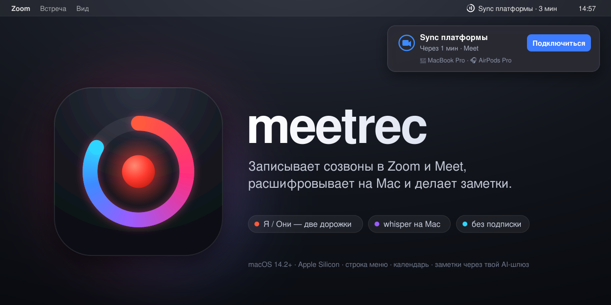

<p align="center"></p>

# meetrec

Лёгкий записыватель созвонов для macOS: живёт в строке меню, знает твой календарь, пишет Zoom / Google Meet
без бота во встрече, расшифровывает **локально** (whisper.cpp на Apple Silicon) и делает заметки через
**твой** AI-агент. Без подписки и без облака посередине.

- **Календарь.** Кольцо в строке меню отсчитывает время до встречи. За минуту до начала появляется плашка
  «Подключиться» с проверкой микрофона и наушников и задачами с прошлой встречи той же серии.
- **Запись в две дорожки.** «Я» — микрофон, «Они» — системный звук. Разделение спикеров точное, без ML.
  Встреча идёт и Zoom занял микрофон: плашка «Записать?». Созвон закончился: «Остановить запись?».
- **★ Метки.** ⌃⌥M во время записи отмечает важный момент. Заметки уделят ему особое внимание.
- **Действия после записи.** Заметки, задачи, конспект или свои промпты, каждое — в свой `.md` в папке встречи.
- **Всё — обычные файлы:** `~/Meetings/<дата>-<встреча>/` с транскриптом, заметками и сжатым аудио.

## Как устроено

```
запись ──► mic.caf («Я»)  +  system.caf («Они», Core Audio process tap)
                    │
                    ▼
     whisper.cpp + VAD на твоём Mac ──► transcript.md
                    │
                    ▼  только текст транскрипта
     твой агент (OpenAI-совместимый API) ──► notes.md · action-items.md · outline.md …
```

**Аудио никогда не покидает Mac.** Агенту уходит только текст транскрипта и название встречи с участниками.
Куда именно — решаешь ты (см. «Агент для заметок»).

## Установка

Нужны **Apple Silicon** и **macOS 14.2+**, Xcode Command Line Tools (`xcode-select --install`) и
[Homebrew](https://brew.sh).

```bash
git clone https://github.com/alvery/meetrec.git && cd meetrec
./scripts/setup.sh        # whisper.cpp + модели large-v3-turbo и silero VAD (~1,6 ГБ, один раз)
./scripts/build-app.sh    # соберёт meetrec.app, поставит в ~/Applications и запустит
```

При первом запуске meetrec попросит доступ к **календарю**, **микрофону** и **записи системного звука**.
Разреши все три. Календари Google подключаются в Системные настройки → Учётные записи интернета.

Обновиться: `./scripts/dev.sh app` (git pull + сборка + перезапуск).

### Постоянная подпись (рекомендуется)

Без неё macOS может заново спрашивать разрешения после каждой пересборки. Сертификат делается один раз:

1. «Связка ключей» → меню «Связка ключей» → «Ассистент сертификации» → «Создать сертификат…»
2. Имя `meetrec-dev`, тип «Самоподписанный корневой», тип сертификата «Подписание кода» → «Создать».
3. `mkdir -p ~/.config/meetrec && echo 'MEETREC_SIGN_ID=meetrec-dev' >> ~/.config/meetrec/env`, затем `./scripts/build-app.sh`.

### Агент для заметок

Без агента после записи будет только транскрипт; meetrec напомнит об этом строкой в окне.
Настраивается в ⚙ (⌘,) → **«Агент»**, кнопка **«Проверить»** показывает, всё ли работает. Варианты:

| Вариант | Что указать | Где обрабатывается транскрипт |
|---|---|---|
| **Свой сервер с Claude** (так сделано у автора) | «SSH-туннель к»: `user@server`; токен — кнопкой «С сервера» | на твоём сервере, по твоей подписке Claude |
| **Любой OpenAI-совместимый API** | «Свой адрес API», токен, модель | у провайдера API |
| **Локальная модель** (Ollama, LM Studio) | адрес вроде `http://127.0.0.1:11434/v1` | на твоём Mac |
| **Claude Code на этом Mac** | явно, в `~/.config/meetrec/env`: `NOTES_CMD="/полный/путь/к/claude -p"` (`which claude`) | у Anthropic, по твоей подписке |

Свой сервер: на сервере с установленным и залогиненным [Claude Code](https://claude.com/claude-code)
выполни `./gateway/install.sh` из этого репозитория. Он поставит `meetrec-gateway` как сервис systemd
(слушает только `127.0.0.1:8787`, наружу ничего не открывается) и создаст токен. Mac ходит к нему по SSH-туннелю,
который meetrec поднимает сам; нужен вход по ключу (`ssh user@server true` без пароля).

## Как пользоваться

Иконка-кольцо в строке меню показывает состояние:

| Иконка | Что значит |
|---|---|
| приглушённое кольцо с полосками «Я / Они» | встреч в ближайший час нет |
| дуга заполняется по часовой | встреча через ≤ 60 мин |
| тающий сектор | встреча идёт, сектор — оставшееся время |
| мигающая точка | встреча идёт, микрофон занят: «Записать?» |
| **красная** точка, кольцо — остаток встречи | идёт запись; за 5 минут до конца кольцо **жёлтое** |
| ★ на секунду | метка поставлена |
| ⋯ / ✓ / ! | делаю заметки / готово / не получилось |

Окно по клику: ближайшая встреча и главная кнопка по фазе («Подключиться» ⌘J, «Записать» ⌘R),
во время записи — уровни дорожек, «Метка» и «Остановить» (⌘.), ниже — пять недавних встреч.
Клик по встрече открывает заметки; при ошибке видно причину и кнопку ↻ «Повторить».
Правый клик: транскрипт, папка, лог, повтор действий или полная обработка.

**Горячие клавиши из любого приложения:** старт / стоп записи — ⚙ → «Горячая клавиша»
(двойное ⌘ / ⌥ / ⌃ / ⇧ или своё сочетание); ★ метка — ⌃⌥M, только во время записи.

**Действия** — ⚙ → «Действия»: стандартные «Заметки», «Задачи» и «Конспект»
([`prompts/actions.default.json`](prompts/actions.default.json)), можно добавить свои,
выбрать модель для каждого и поменять порядок. Хранятся в `~/.config/meetrec/actions.json`.

**Иконка пропала?** На MacBook с вырезом macOS прячет иконки, которым не хватило места слева от выреза.
Перетащи meetrec ближе к часам: ⌘ + перетаскивание мышью.

**Советы:** пользуйся наушниками (иначе голоса собеседников попадут и в дорожку «Я»). Звук уведомлений
и музыки во время созвона тоже попадёт в запись.

## Для разработки

```bash
swift build -c release                     # CLI: .build/release/rec
.build/release/rec ~/Meetings/test         # запись из терминала (Ctrl+C — стоп)
./scripts/process.sh ~/Meetings/test       # обработка: whisper → transcript.md → действия
./scripts/process.sh --actions-only DIR    # только действия (транскрипт уже есть)
./scripts/mock-meeting.sh --day            # тестовые встречи в отдельном календаре meetrec-test
./scripts/mock-meeting.sh --clean          # удалить их
```

Из терминала разрешения выдаются **приложению терминала**. Системный звук терминалу выдаётся вручную:
Конфиденциальность и безопасность → «Запись экрана и системного звука» → нижний список
«Только запись системного звука» → + → терминал.

Настройки обработки — в `~/.config/meetrec/env` (`KEY=value`, переменные командной строки важнее):

| Переменная | По умолчанию | |
|---|---|---|
| `WHISPER_LANG` | `ru` | `ru`, `en` или `auto` |
| `WHISPER_MODEL` | `models/ggml-large-v3-turbo.bin` | любая ggml-модель whisper.cpp |
| `NOTES_CMD` | `claude -p` | команда для действий без шлюза (лучше с полным путём): промпт — последним аргументом, транскрипт — в stdin |
| `KEEP_RAW` | `0` | `1` — не сжимать исходные .caf в .m4a |
| `MEETREC_REPORT_HOST` | — | `user@server`: после обработки отправлять технический отчёт по SSH (без аудио и текста) |

Отладочные отчёты (`scripts/report.sh`) выключены, пока не задан `MEETREC_REPORT_HOST`. В них только
технические данные: версии, устройства, параметры файлов, логи `rec.log` / `process.log`.
Аудио, транскрипты и заметки не отправляются.

Что нового — [CHANGELOG.md](CHANGELOG.md). Требования и план — [SPEC.md](SPEC.md). Иконку рисует `scripts/make-icon.swift`, обложку — `docs/make-cover.py`.

## Лицензия

[MIT](LICENSE)
